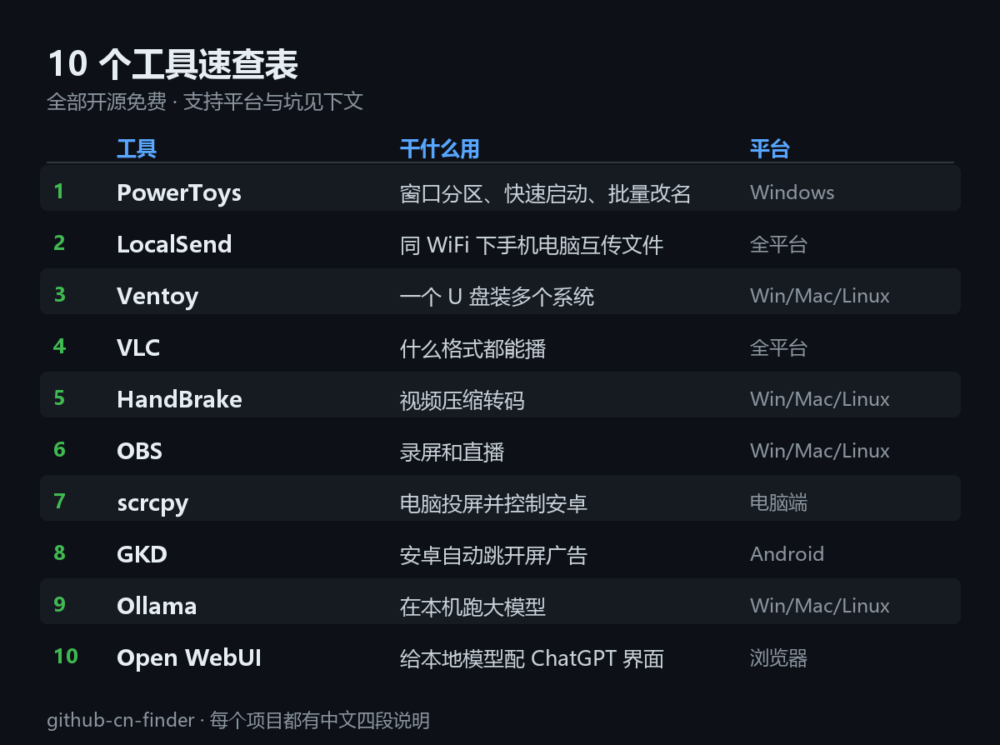
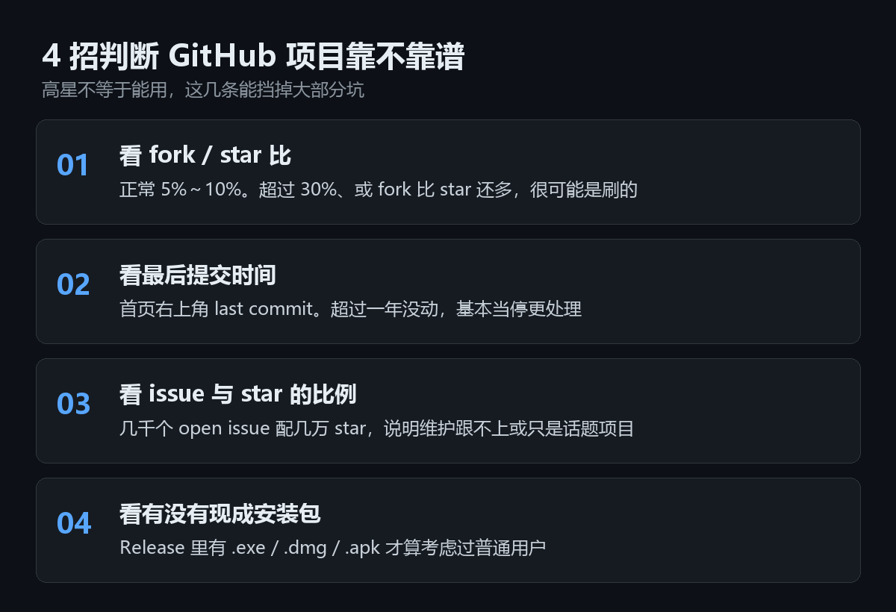

# GitHub 上全是英文看不懂？我整理了 172 个开源软件的中文说明书，先挑这 10 个装

> 每个工具都写清楚：干什么用、支持哪些平台、最容易踩的坑。
> 不是"收藏了 100 个链接"那种清单——这里每个我都写了坑。

---

## 先说个实话：GitHub 对普通人确实不友好

你去 GitHub 想找个软件用，会遇到三个坎：

**第一坎是英文。** README 是英文，安装说明是英文，连报错都是英文。

**第二坎是"不知道下哪个"。** 一个项目动不动十几个 Release 文件，`win-x64.zip`、`Setup.exe`、`portable.zip` 摆在一起，没人告诉你该点哪个。

**第三坎是坑。** 装完了发现要开命令行、要装 Python、要注册账号——这时候大部分人就直接关掉了。

所以下面这份清单，我按「普通人真的能装起来」这个标准筛的。全都是在 GitHub 上开源、免费、不需要注册账号的软件。

---

## 一、Windows 装机必备（3 个）

### 1. PowerToys —— 微软官方出的效率工具包

**是什么**：不是一个软件，是十几个小工具的合集。最有用的三个：

- **PowerToys Run**：按 `Alt + 空格`，输入几个字母就能启动任何程序，不用再去开始菜单里翻
- **FancyZones**：把屏幕切成自定义区域，窗口拖进去自动吸附排版
- **批量重命名**：几十个文件一次改名，还支持正则

**平台**：Windows 10 / 11
**坑**：装完是空的——它默认只装了一部分模块，得进设置把你要的开关打开。

star 十四万+，微软在维护，可以放心用。

### 2. LocalSend —— 手机和电脑之间传文件

**是什么**：同一个 WiFi 下，手机和电脑互传文件。**不经过任何服务器，不压缩画质，不用登录微信。**

**为什么值得装**：用微信传文件会压画质、有过期时间；用 QQ 要装两个端；LocalSend 是开箱即用——两端打开，自动发现对方，点一下就开始传。

**平台**：安卓 / iOS / Windows / macOS / Linux
**坑**：两端必须在**同一个局域网**。公司、学校的公共 WiFi 常开了"客户端隔离"，这种情况下互相发现不了，得改用手机热点。

### 3. Ventoy —— 一个 U 盘装遍所有系统

**是什么**：传统做启动盘，每次换系统都要重新格式化 U 盘。Ventoy 是把 U 盘装一次，之后**只要把 ISO 文件拷进去**，开机选 U 盘就能进那个系统的安装界面。可以同时放好几个系统。

**平台**：Windows / Linux / macOS
**坑**：**第一次安装会格式化整个 U 盘**，里面有东西先备份。另外它是"启动盘"，不是"随身硬盘"，日常存文件不建议。

---

## 二、影音处理（3 个）

### 4. VLC —— 什么格式都能播

**是什么**：万能播放器。MKV、RMVB、AVI、TS、甚至损坏的视频文件，它基本都能播。还有个实用功能：能直接播网络串流地址。

**平台**：全平台（Win / Mac / Linux / 安卓 / iOS）
**坑**：界面停留在十年前，丑是真的丑。如果你追求"好看"，用 PotPlayer 这类；但如果你的需求是"这个文件别的播放器打不开"，VLC 是最后一招。

### 5. HandBrake —— 视频压缩和转码

**是什么**：把视频转格式、压体积。典型场景：手机拍的 4K 视频太大发不出去、下载的视频格式电视不认、想把一堆视频统一成 MP4。

**平台**：Windows / Mac / Linux
**坑**：参数特别多，第一次看会懵。**别改参数**——右下角预设选 `Fast 1080p30`，直接开始就行。压缩比的合理预期是：体积减到 1/3~1/5，画质肉眼基本看不出差别。

### 6. OBS Studio —— 录屏和直播

**是什么**：免费录屏、直播推流的老大。录教程、录游戏、给同事录操作演示，都用它。

**平台**：Windows / Mac / Linux
**坑**：第一次开是黑屏——因为默认场景是空的，得先「添加来源 → 显示器采集」。另外编码器选错会录出来卡顿：有独立显卡就选硬件编码（NVENC / QSV），没有就选 x264。

---

## 三、手机上（2 个）

### 7. scrcpy —— 电脑投屏并控制安卓手机

**是什么**：把安卓手机的画面投到电脑上，并且能用鼠标键盘直接操作手机。延迟极低，还免费。

**平台**：电脑端（Win / Mac / Linux）
**坑（这条我要说重一点）**：它本质上是**投屏 + 控制**工具，不是"手机管家"。我实际用过，几个短板很明确：

- 要手动开「USB 调试」，小白第一次会卡在这一步
- **没有图形界面**，纯命令行，参数要自己记
- 无线连接要先用 USB 配对，断了常常要重来
- 中文输入会调用手机输入法，用电脑键盘打字容易出怪问题

如果只是要投屏看手机、或者用电脑回消息，它非常够用；要"文件管理 + 剪贴板 + 多设备"那种一条龙，得看别的。想要图形界面的，可以搜 QtScrcpy（套壳版，限制跟它一样）。

### 8. GKD —— 安卓自动跳开屏广告

**是什么**：每天打开 App 被 3 秒开屏广告挡住，它按规则帮你自动点掉那个「跳过」。

**平台**：Android
**坑**：需要开「无障碍权限」，这是敏感权限，装之前自己权衡。规则要订阅别人的规则库，规则失效时要更新——不是"装完永久有效"。

---

## 四、AI 本地跑（2 个）

### 9. Ollama —— 在自己电脑上跑大模型

**是什么**：一句命令把大语言模型下载到本地运行，断网也能用，数据不出本机。

**平台**：Windows / Mac / Linux
**坑**：**模型有体积**。7B 级别的模型大约 4~5 GB，跑起来需要 8 GB 以上内存；想跑更大的模型，得看显卡。另外它默认是命令行的，普通人会不知道怎么聊天——所以配第 10 个。

### 10. Open WebUI —— 给 Ollama 配个 ChatGPT 那样的界面

**是什么**：一个网页版的聊天界面，接上本地的 Ollama，用起来就跟用 ChatGPT 一样：历史对话、多模型切换、上传文件。

**平台**：浏览器访问（本机部署）
**坑**：官方推荐 Docker 部署，这步对完全没碰过命令行的人有门槛。装之前先确认自己电脑装了 Docker。

---

## 附：怎么判断一个 GitHub 项目靠不靠谱

这部分可能比上面 10 个工具更值钱。GitHub 上高星项目里，有一批是**刷出来的**，我前段时间筛项目时踩到过。四个判断标准：

**1. 看 fork 和 star 的比例**
正常项目 fork 数大概是 star 数的 5%~10%。如果一个项目 fork 率超过 30%，或者 fork 数比 star 还多，很可能是刷的。

**2. 看最后提交时间**
GitHub 每个仓库首页右上角有 "last commit"。**超过一年没动的，基本可以当弃坑处理**——不是说不能用，而是出了问题没人修。

**3. 看 open issue 和 star 的比例**
几百个 issue 配几万 star 是正常的；但如果**几千个 open issue 只配几万 star**，说明作者根本处理不过来，或者项目本身就是"话题项目"而非真工具。

**4. 看有没有能直接装的东西**
Release 页面里有 `.exe`、`.dmg`、`.apk` 的，说明作者考虑了普通用户；只有源码和 "build from source" 的，那是给开发者用的。

按这四条筛，能挡掉大部分坑。

---

## 最后

上面这些项目，我整理成了一个站：**每个都写了中文的四段说明——应用场景 / 主要功能 / 适用平台 / 怎么用起来**，目前收了 172 个，按 AI、实用工具、影音、手机 App、学编程等分了类。

不用注册、没有广告、手机上也能直接打开：

👉 **https://p0w3rd1n8.github.io/github-cn-finder/?from=zhihu**

如果你只是想知道「某个软件有没有开源替代品」，也可以拿站内的搜索框直接搜中文，比如搜"压缩"、"播放器"、"做笔记"。

---

*本文提到的软件全部开源且免费。安装任何项目前，请以项目官方文档为准；涉及权限（无障碍、USB 调试、Docker）的操作，请自行评估风险。*
